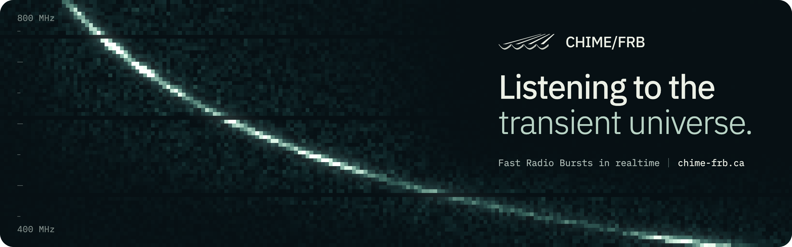

 

CHIME/FRB is the fast radio burst project of the [Canadian Hydrogen Intensity Mapping Experiment](https://chime-experiment.ca/) (CHIME), a radio telescope at the Dominion Radio Astrophysical Observatory near Penticton, British Columbia. Its four cylindrical reflectors watch a wide strip of the northern sky as the Earth turns, while software searches the incoming signal in real time for fast radio bursts: millisecond flashes of radio light from distant galaxies.

The collaboration publishes its catalogs and data products at **[chime-frb.ca](https://chime-frb.ca)**, free for research and public use.

#### Explore the data

| Resource | What it's for |
|---|---|
| **[Catalogs](https://chime-frb.ca/catalogs)** | Every published CHIME/FRB catalog. Search and sort the bursts, open any one for its full measurements, or download a catalog in full. |
| **[Public API](https://chime-frb.ca/tutorials#api)** | Read-only JSON over HTTPS for every published catalog. No key or sign-up needed. |
| **[Tutorials](https://chime-frb.ca/tutorials)** | Query the API, read the catalog files and work with raw data, with Python examples. |
| **[Raw data](https://chime-frb.ca/tutorials#raw-data)** | High-time-resolution data products, archived with permanent DOIs. |
| **[Open data docs](https://chime-frb-open-data.github.io/)** | Documentation for `cfod`, the Python package for CHIME/FRB open data. |

#### Using the data

Each catalog on [chime-frb.ca](https://chime-frb.ca/catalogs) lists the papers to cite. Please cite them when you use its data in your work.

#### Get in touch

- **Data questions, bug reports and feature requests:** open an issue on [chime-frb-open-data/community](https://github.com/chime-frb-open-data/community/issues).
- **General enquiries:** [chimefrb@gmail.com](mailto:chimefrb@gmail.com)
- **The telescope:** [chime-experiment.ca](https://chime-experiment.ca/)

#### The collaboration

CHIME/FRB brings together astronomers, engineers and students from its member institutions. Together they built and run CHIME's real-time search for fast radio bursts. [Meet the collaboration](https://chime-frb.ca/about).

 

[chime-frb.ca](https://chime-frb.ca) · [Catalogs](https://chime-frb.ca/catalogs) · [Tutorials](https://chime-frb.ca/tutorials) · [About](https://chime-frb.ca/about) · [CHIME Experiment](https://chime-experiment.ca/)
